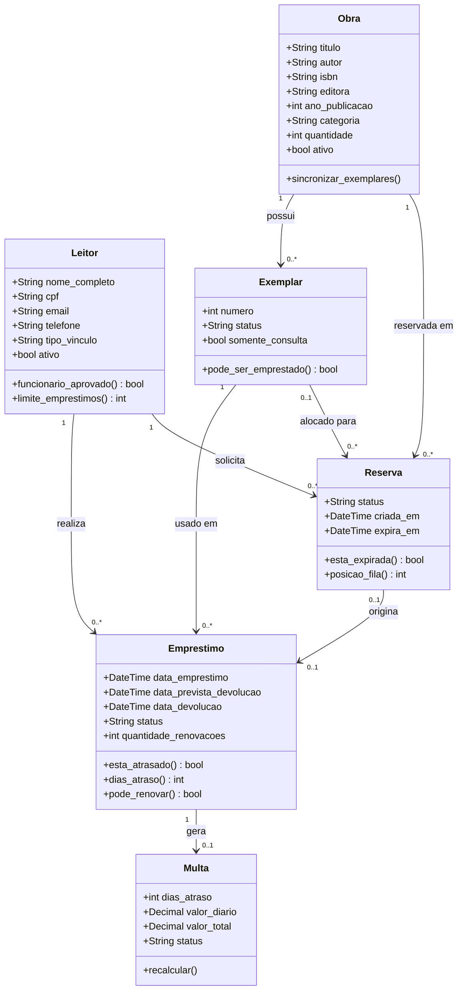
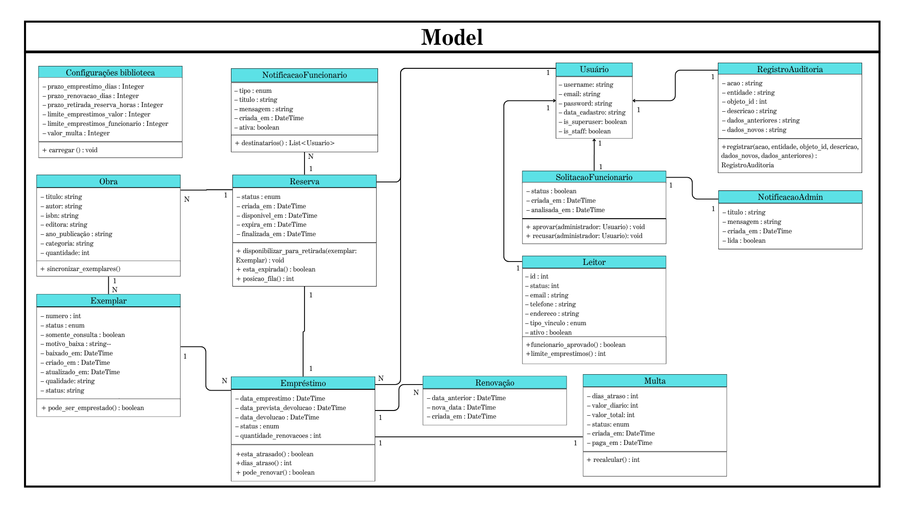

# 📚 BiblioSys — Sistema de Gerenciamento de Biblioteca


**BiblioSys** é um sistema web completo para gerenciamento de bibliotecas desenvolvido em **Python / Django**, cobrindo todo o ciclo operacional de acervo, circulação, reservas, multas, auditoria e relatórios gerenciais, validado por **53 testes automatizados**.

---

## ✨ Principais Funcionalidades

- 📖 **Gestão de Acervo**: Cadastro de obras e controle individualizado de exemplares (com reserva automática do Exemplar #1 para consulta local e *soft delete* via flag `ativo`).
- 👥 **Gestão de Leitores e Perfis**: Diferentes categorias de vínculo (*Aluno*, *Professor*, *Funcionário*, *Público Externo*) com limites dinâmicos de empréstimo e fluxo de aprovação de funcionários.
- 📤 **Circulação (Empréstimos e Devoluções)**: Controle de prazos, renovações (limite de 1 renovação por empréstimo) e validação de disponibilidade.
- 📋 **Sistema de Reservas com Fila**: Fila ordenada cronologicamente com expiração automática e notificações para a equipe.
- 💰 **Gestão de Multas**: Cálculo automático de penalidades por dias de atraso com atualização de status (*Pendente*, *Paga*, *Cancelada*).
- 📊 **Relatórios e Auditoria**: Painel com métricas de circulação, histórico filtrável por período/status/leitor/obra e trilha de auditoria administrativa.
- 🔐 **Autenticação e Segurança**: Controle de acesso por perfil e fluxo completo de recuperação de senha via e-mail.

---

## 🏗️ Arquitetura e Modelagem de Dados



---

## 📁 Estrutura do Repositório

```text
bibliosys/
├── biblioteca/                      # Aplicação principal Django
│   ├── models.py                    # Modelos de domínio (Obra, Exemplar, Leitor, Emprestimo, Reserva, Multa)
│   ├── servicos_circulacao.py       # Regras de negócio de empréstimo, devolução, reserva e multa
│   ├── views.py                     # Views principais e dashboard
│   ├── views_livros.py              # CRUD de obras e exemplares
│   ├── views_leitores.py            # Gestão de leitores
│   ├── views_circulacao.py          # Operações de empréstimo, renovação, devolução e reserva
│   ├── views_historico.py           # Histórico com filtros avançados
│   ├── views_relatorios.py          # Relatórios e indicadores gerenciais
│   ├── views_auditoria.py           # Logs de auditoria e notificações
│   ├── views_autenticacao.py        # Login, cadastro e recuperação de senha
│   ├── forms*.py                    # Formulários e validações
│   ├── urls.py                      # Rotas da aplicação
│   ├── tests.py                     # Suíte principal de testes automatizados (53 testes)
│   ├── templates/biblioteca/        # Templates HTML responsivos
│   └── static/biblioteca/           # Estilos CSS e ativos estáticos
├── config/                          # Configurações globais do projeto Django
│   ├── settings.py
│   ├── urls.py
│   └── wsgi.py
├── docs/                            # Artefatos de Engenharia de Software
│   ├── Documento_de_Requisitos.pdf  # Especificação formal de requisitos
│   ├── Diagrama_de_Classes.png      # Diagrama UML de classes
│   ├── Diagrama_de_Casos_de_Uso.pdf # Diagrama UML de casos de uso
│   └── RELATORIO_BIBLIOSYS.md       # Relatório técnico detalhado da arquitetura
├── templates/admin/                 # Customização do Django Admin
├── manage.py                        # Utilitário de linha de comando Django
├── requirements.txt                 # Dependências Python (UTF-8)
└── README.md                        # Documentação principal
```

---

## 🚀 Instalação e Execução

### 1. Clonar o repositório
```bash
git clone https://github.com/AmandoLuizDaCruz/bibliosys.git
cd bibliosys
```

### 2. Criar e ativar o ambiente virtual
```bash
python3 -m venv .venv
source .venv/bin/activate      # Linux / macOS
# .venv\Scripts\activate       # Windows
```

### 3. Instalar dependências (UTF-8)
```bash
pip install -r requirements.txt
```

### 4. Aplicar migrações e iniciar o servidor
```bash
python manage.py migrate
python manage.py createsuperuser
python manage.py runserver
```
Acesse no navegador: **`http://localhost:8000`**

---

## 🧪 Execução dos Testes Automatizados (53 Testes)

Para rodar toda a suíte de testes unitários e de integração (modelos, serviços de circulação, formulários, autenticação e views):

```bash
python manage.py test biblioteca --verbosity=2
```

---

## 📚 Documentação de Engenharia de Software (`docs/`)

- 📄 **[Documento de Requisitos (PDF)](./docs/Documento_de_Requisitos.pdf)**
- 📐 **[Diagrama de Casos de Uso (PDF)](./docs/Diagrama_de_Casos_de_Uso.pdf)**
- 🖼️ **[Diagrama de Classes (PNG)](./docs/Diagrama_de_Classes.png)**
- 📘 **[Relatório Técnico Completo (`RELATORIO_BIBLIOSYS.md`)](./docs/RELATORIO_BIBLIOSYS.md)**



---

## 👨‍💻 Autores

- **Amando Luiz da Cruz** — [GitHub](https://github.com/AmandoLuizDaCruz)
- **Matheus Kersul** — [GitHub](https://github.com/MatheusKersul)
- **Nattan Montel** — [GitHub](https://github.com/n4ttan)
